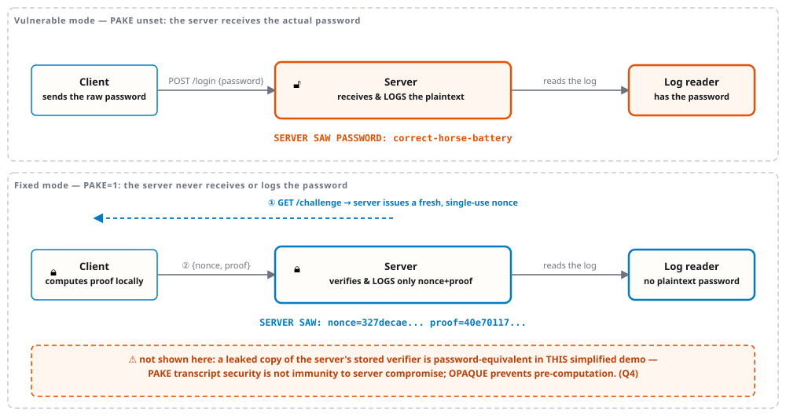

<!-- Delivery: 100-minute lab-focused session. 10 Week 13 retrieval quiz + 10 brief + 60 practice + 15 debrief + 5 evidence. The scored Week 14 quiz opens Week 15. Full slides and questions are retained as preparation/extension material; individual slide minute estimates are pacing aids, not an additional lecture block. Everyone completes shared60 + assigned Conventional40 or AIR20/10/10. Viva is formative, no extra points. See the worksheet core/extension plan. -->

# Week 14
## User Authentication (challenge-response, PAKE, MFA)
Cryptography and Network Security · Nutthakorn Chalaemwongwan

<!-- Hook: ask "when you type your password into a login form, who actually sees it?" TLS protects the path, but the receiving server handles the plaintext. Password submission over TLS is a common legitimate design when credentials are handled safely; the deliberate logging in this lab is the flaw. ~2 min. -->

---

## Today

- Why sending a password to the server is a risk — **even over TLS**
- Challenge-response: proving you know a secret without saying it
- PAKE (SRP, OPAQUE) and what our demo does *not* give you
- Auth factors, TOTP vs FIDO2, credential stuffing, SSO/OIDC
- 🗝️ Game: **Never Say the Password**

<!-- Roadmap, 1 min. Flag the lab up front: run the same login demo in vulnerable and fixed mode, inspect server and client logs in each, and inspect the fixed-mode request code. Also flag this is a HYBRID week — half runnable demo, half conceptual essays (TOTP/FIDO2/SSO). ~1 min. -->

---

## Recap — Week 13

- Week 13's **honest relay** could not read message content; endpoint key trust still mattered
- Same server, same log line — plaintext vs. ciphertext, purely by *where* encryption happens
- This week: same question, different secret — can the server even avoid **learning your password**?

<!-- Bridge from W13. W13 = protect message *content* from the server operator. W14 = protect a *credential* from the server operator. Same underlying move: shrink what the "trusted" server structurally holds. Ask: "if E2EE keeps your messages from the server, why does almost every login form just... hand the server your password?" ~3 min. -->

---

## The premise: TLS protects the wire, not the endpoint

- TLS encrypts the **network path** between client and server
- The server **terminates** TLS — it decrypts the request and sees it in the clear
- "Log in by sending your password" hands the **plaintext** to the server itself
- A malicious, compromised, or merely over-logging server has it — TLS never touches this

<!-- Draw the boundary: TLS protects the network path; the server decrypts the request and can process its contents. The relevant failure here is logging the plaintext password, not ordinary password submission over TLS. ~5 min. -->

---

## Worked example: vulnerable mode

```
POST /login {"username":"alice","password":"correct-horse-battery"}
```

```
week14-server  | SERVER SAW PASSWORD: correct-horse-battery
week14-client  | LOGIN OK
```

- The plaintext password reaches the **server's request handler** by design
- The deliberate log line exposes it — **CWE-532** (and insufficient credential protection under CWE-522)
- Login still "works" — that's what makes this easy to ship and easy to miss

<!-- This is the exact `docker-compose.vulnerable.yml` output from the lab — point at the literal log line they'll capture. The lab itself uses HTTP only inside Docker. Hypothetical TLS would protect the path, but the server would still receive plaintext after terminating it. CWE-319 describes unencrypted transport, not this endpoint exposure. ~5 min. -->

---

## Toy alternative: challenge-response in three steps

1. Server sends a fresh random **nonce** (never reused)
2. Client combines `nonce + password` **locally** → a **proof**
3. Server checks the proof against a stored **verifier** — never against the password

> The server asks for a fresh proof. In this toy protocol, a thief with the stored verifier can answer too.

<!-- Draw the three-step exchange on the board. Emphasize "locally" in step 2 — the login request sends no password. This toy proof establishes possession of the verifier or the ability to derive it; it does not establish password-only knowledge against verifier theft. ~5 min. -->

---

## How verification works without the plaintext

- This demo **preloads a verifier** `v = KDF(salt, password)` and a public salt; it has no signup flow
- Client computes `proof = HMAC(v, nonce)` locally, using the password it just typed
- Server independently recomputes the same proof from its stored `v` and the nonce it issued, and **compares**
- Match → `LOGIN OK`. The fixed-mode login request contains no password

<!-- Walk the symmetry: both sides compute the same HMAC, but the fixed-mode server has only a precomputed verifier, not the raw password. Ask: "if an attacker steals v, can they log in as alice directly?" (YES — in THIS demo v is password-equivalent: the thief requests a fresh nonce and computes HMAC(v, nonce). The fresh nonce only stops replay by someone who does NOT hold v. Do not claim OPAQUE prevents all offline guessing after full server compromise; distinguish transcript security and pre-computation resistance (RFC9807 section10.11).) ~6 min. -->

---

## Who sees the secret?



```sim
cred-harvest
```

<!-- The sim runs REAL SHA-256 and REAL HMAC-SHA256 in the browser (verified against Node's crypto module before shipping) — not a toy hash like mac-extend.js, since this week's lab genuinely calls hashlib.sha256/hmac.new. What's illustrative: the three login scenarios and their "reused password" second accounts are invented framing, not literal lab code. Run it live right here — flip Mode from plain to challenge-response on one preset and read the log line change in real time, then click "Replay the captured request" in fixed mode to show the single-use nonce rejecting its own captured request. The offline-guess panel previews the Honest Scope slide's gap (a leaked verifier is crackable offline) without spoiling it — don't over-explain that part yet. ~4 min. -->

---

## Worked example: fixed mode

```
GET /challenge?username=alice -> nonce=327decae..., salt=...
POST /login {"username":"alice","nonce":"327decae...","proof":"40e70117..."}
```

```
week14-server  | SERVER SAW: nonce=327decaec7e5... proof=40e701177990...
week14-client  | LOGIN OK
```

```text
docker compose -f docker-compose.fixed.yml logs server
docker compose -f docker-compose.fixed.yml logs client
```

- Same successful login, same demo account — no password string in the fixed-mode **server log**

<!-- The payoff slide — same LOGIN OK, different log content. Have students inspect both logs and the fixed-mode request construction in client.py. Log absence alone is limited evidence and cannot prove what crossed the network. These commands work in PowerShell and Mac Terminal. ~4 min. -->

---

## Honest scope — this is NOT a full PAKE

This fixed-mode client demonstrates one property: *its login request omits the password.*

A real PAKE adds **mutually authenticated key exchange** and resistance to **offline guessing from protocol transcripts**, under its assumptions.

For **OPAQUE**, full server compromise can still allow offline password guesses. Its additional guarantee is resistance to **pre-computation**; key stretching increases guess cost. Keep these threat models distinct. [RFC 9807, Sections 1 and 10.11](https://www.rfc-editor.org/rfc/rfc9807.html#section-10.11).

<!-- Compare the toy protocol's password-equivalent verifier and known-salt transcript attack with PAKE transcript security. The observed absence of a plaintext password is not proof of a production authentication protocol. -->

---

## Audit the AI — a "professional-looking" login handler

```python
log.info("login attempt: %s", body)                                   # (A)
...
log.warning("login FAILED for %s (pw=%s)", body["username"],
            body["password"])                                         # (B)
```

- `bcrypt.checkpw(...)` against the stored hash is **correct**
- But `(A)` logs the **full request body**, `(B)` logs the **raw password** — CWE-532
- The bcrypt hash was never the leak. The **log file** is.

<!-- Mirrors the model's "worked example: what each tool catches" — same idea, a plausible AI-generated snippet with a planted flaw. Ask: "who can read production logs?" (log-aggregation SaaS, on-call engineers, anyone who breaches the log store). This is Worksheet Part 2b — point them at it directly, and ask them to name what place the credential reaches in Part 2a-vulnerable vs. here (answer: the log file, in both cases). ~5 min. -->

---

## Authentication factors

| Factor | Example | Weakness |
|---|---|---|
| **Know** | password, PIN | phishable, reusable, guessable |
| **Have** | phone, FIDO2 key | can be lost/stolen; SIM-swap for SMS |
| **Are** | fingerprint, face | can't be rotated if compromised |

- **MFA** = combine factors from *different* rows — not two passwords

<!-- Standard NIST 800-63B taxonomy. Ask for one example + one weakness of each before revealing the table. Stress: two "know" factors (password + security question) is not MFA — it's one factor asked twice. ~5 min. -->

---

## TOTP vs FIDO2/WebAuthn

- **TOTP** (authenticator app): a shared secret + current time → a 6-digit code you **type**
  - Phishable — a fake login page can relay your code to the real site in real time
- **FIDO2/WebAuthn**: a private key on your device signs a challenge **bound to the relying-party origin**
  - Resists lookalike-site phishing because a signature for the fake origin will not verify for the real site

<!-- Key contrast: what the user types vs. what the authenticator does, and what each is bound to. TOTP is bound to nothing — you can paste that 6-digit code into any site that asks. FIDO2 is cryptographically bound to the origin, so a phishing clone at a lookalike domain gets a signature that simply doesn't verify. This is Worksheet Q5. ~5 min. -->

---

## Credential stuffing

- Attacker takes passwords leaked from **breach A**, tries them against **site B**
- Works because people **reuse** passwords across sites
- Strong mitigation: **MFA**, preferably phishing-resistant — a correct, reused password alone no longer logs the attacker in

<!-- Worksheet Q6. Ask "why does reusing your own login as the mitigation still help even when the leaked password really is correct for that account?" — because credential stuffing is *automated, password-only* login; add any second factor and the automation breaks even with a 100% correct password. ~3 min. -->

---

## Delegated authentication: SSO / OIDC

- User authenticates with an **identity provider** (Google, institutional SSO…)
- In an OIDC sign-in flow, the relying app receives an identity assertion/token, not the IdP password
- Fewer passwords to phish or reuse — but the IdP becomes a **single point of failure**

<!-- Worksheet Q8. The IdP is now the one account that, if compromised, unlocks everything federated to it — "don't put all your eggs in one basket" cuts both ways. Connect back to mutual authentication from the honest-scope slide: SSO buys you a lot, but concentrates trust. ~4 min. -->

---

## 🗝️ Signature game — Never Say the Password

- Play server operator: run **vulnerable mode**, watch your own log hand you the plaintext password
- Flip to **challenge-response mode**, log in successfully, then inspect your server log and request code
- A "Sign in with…" button usually uses delegated identity (for example OIDC), a different mechanism

<!-- Explain the game before lab: it's not a CTF flag hunt. The evidence is a successful fixed-mode login, a server log without the plaintext, and code showing that the client request omitted it. Emphasize that the students run the packet on their own machines. ~3 min. -->

---

## Lab today

**Shared practical/analysis core: 60 points for everyone.** Complete only your assigned **Conventional written 40** or **AIR-Sec Audit 20 + EiPE 10 + Prompt 10**. Each version totals 100; viva is formative. Full questions remain in the worksheet, with extensions outside the 100-minute class.


> 📋 **Worksheet 14** — `labs/week14-authentication/worksheet.md` · run: `docker compose -f docker-compose.vulnerable.yml up --build --abort-on-container-exit`, then the `.fixed.yml` variant

- Capture both modes and inspect the fixed-mode request code and server/client logs
- **AIR-Sec:** Audit the AI, Explain in Plain English and Prompt Problem
- **Conventional:** eight assigned essay questions
- Viva is formative; finish longer responses outside class

<!-- The graded output for this HYBRID week. Remind: this is a read/run/observe lab, not an exploit-and-fix lab — code is unchanged, evidence is captured logs + identity proof. Point to the "Honest scope" box in the README before they write Part 2c/2d so they don't overclaim PAKE properties this demo doesn't have. -->

---

## Key takeaways

- TLS protects the **wire**; it says nothing about what the **endpoint** does with your plaintext
- This toy sends no password in the login request but accepts anyone holding its verifier
- TLS-protected password submission can be appropriate, but the receiving server must protect the credential and avoid logging it

<!-- Recap, 3 lines. Cold-call: "your friend says their login is secure because the login page uses HTTPS — what's missing from that claim?" ~3 min. -->

---

# Questions?
Next week: Post-Quantum Cryptography

<!-- Cliffhanger: "the public-key math we've leaned on all semester — RSA, Diffie-Hellman — assumes a certain kind of problem is hard. Next week we ask what happens when a quantum computer makes that assumption false. (Note: our hash-based verifiers today SURVIVE — Grover only halves symmetric/hash strength; it's the public-key primitives that break.)" Remind: Docker stacks ready for both compose files before lab starts. -->
